# Tesseract

A desktop app for code review in Plastic SCM (Unity Version Control) and GitHub.

AI tools make code changes faster and bigger, so reviews take more and more time. The standard
review view is a flat list of files. It shows the diff, but not the context: who calls this code,
what it calls, and which other changes belong to the same idea. Tesseract shows a review as a
graph of related changes, puts the context next to the code, and connects the discussion to
Claude Code.

In Plastic, the app reads and writes everything through the `cm` command line client. On GitHub,
it reads and writes pull requests through the `gh` command line client, and it reads the code
from your local git clone. It works with the reviews, comments and reviewers that already exist on
the server, so the rest of the team can keep using the Plastic GUI or the GitHub website.

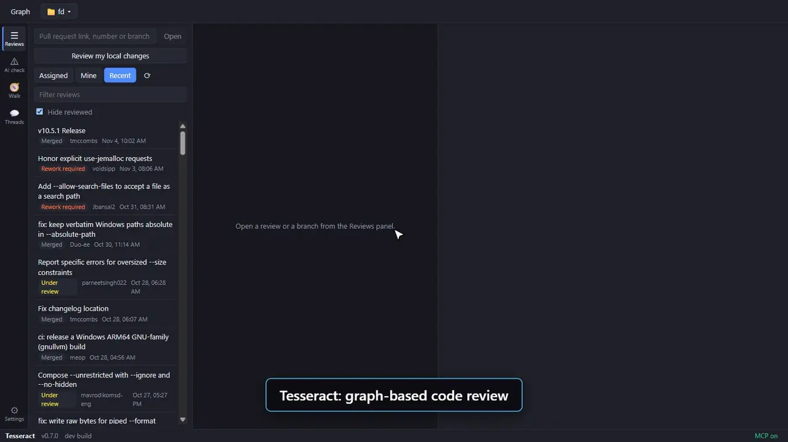

The clips show the review of the public pull request [sharkdp/fd#1976](https://github.com/sharkdp/fd/pull/1976).

## Features

The features follow the steps of a review: open it, understand it, check the risky parts, and
discuss them.

### 1. Open a review

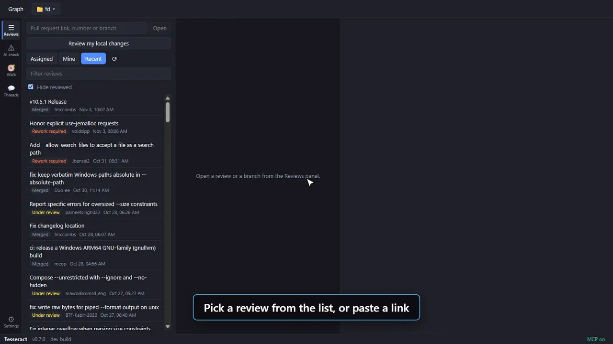

- The activity bar on the left switches between the panels: **Reviews**, **AI check**, **Walk**,
  **Threads** and **Settings**. Click the active button again to hide the panel and get more room.
- The Reviews panel lists the reviews assigned to you, the reviews you created, and recent
  reviews. Type in the filter box to search by id, title or owner.
- Paste a Plastic review link into the box at the top of the panel, for example a link from a
  chat message, and click "Open". The box also takes a review id or a branch such as
  `/main/task-123`. A branch opens without a review, so it has no comments.
- In a GitHub repository, the box takes a pull request link, a pull request number, or a branch
  such as `feature/task-123`.
- Shortcut: copy a review link or a pull request link and press Ctrl+V anywhere outside a text box.
- "Review my local changes" checks your own work before you send it to a code review. In Plastic it
  opens the pending changes of the workspace. In git it opens the commits that are not pushed yet,
  plus the changes that are not committed. The new side of each file is the file on disk, so click
  "⟳ Reload" in the top bar after you edit. The selected unit stays selected.
- The top bar shows the review, your progress, and the status of each reviewer. "I reviewed it"
  and "Rework required" set your own status in Plastic. On GitHub, the buttons are "Approve" and
  "Request changes".
- The folder button in the top bar switches between workspaces. A folder with a `.plastic` folder
  is a Plastic workspace, and a folder with a `.git` folder is a GitHub repository.
- The changesets button in the top bar (commits on GitHub) lists the changesets of the branch.
  Click one, or Shift+click a second one for a range, and "Review chosen" opens only those
  changes. After the author pushes fixes, a "N new since your last visit" button opens only the
  new changesets. A range has its own reviewed marks, so units that changed again show as not
  reviewed.
- The ⚙ Settings panel at the bottom of the left bar has three pages and a search box:
  - "Claude" sets the model and the effort of each kind of Claude task. The app starts with its
    own choice for each task, for example Haiku for cluster summaries and Opus for the AI
    pre-review. "Claude Code default" lets Claude Code choose. If a model is not available, the
    task uses the Claude Code default.
  - "Files" hides files from reviews by glob pattern, for example `*.dll` or `Binaries/`. The app
    does not download hidden files, so big changes open faster. "Add common binaries" fills in the
    usual build outputs. The patterns apply to the next review that you open.
  - "Saved data" shows and clears the data that the app keeps (see section 4).

### 2. Graph of changed code, with its context

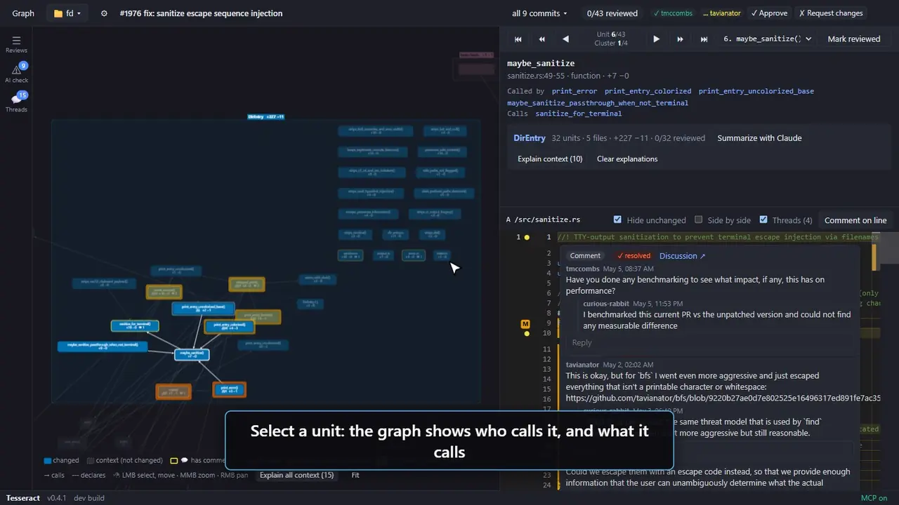

- Each node is a unit of change: a function, the declarations of a class, or a whole file.
- Arrows show calls between units. Dashed arrows connect a header declaration to its definition.
- Nodes with a dashed border are context: code that did not change, but that a changed unit calls
  or is called by.
- Select a unit to see its "Called by" and "Calls" links, and the diff of only that unit. The
  graph fades the units that are not related to it.
- A suggested reading path puts callers before callees. The bar at the top of the side panel walks
  it unit by unit or cluster by cluster. "Mark reviewed" is in the same bar, and the top bar counts
  the progress.

C++ and Rust code is parsed with tree-sitter. Unreal macros such as `UCLASS`, `UFUNCTION` and
`*_API` are removed before parsing, so Unreal headers parse correctly. A Rust method gets the type
of its `impl` or `trait` block as its class.

Unreal `.uasset` files are read too, so a binary asset is not a blank node:

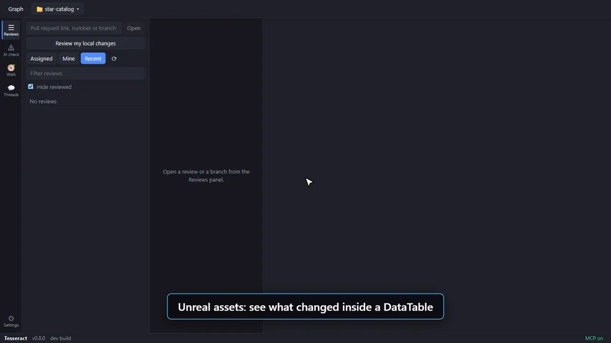

- Each changed Blueprint graph is a unit. Its view draws the nodes and wires, and marks what was
  added, removed or changed.
- Data Assets, DataTables and the class defaults of Blueprints get a property table: each changed
  value with its old and new value, for example `Weapons[2].Damage: 30 -> 40`. A DataTable shows
  the rows that were added, removed or changed. "(not set)" means that the asset does not save the
  value, so it uses the default. Type in the filter box to find a property.
- Claude and the MCP tools get the same changes as text.

### 3. Clusters and summaries

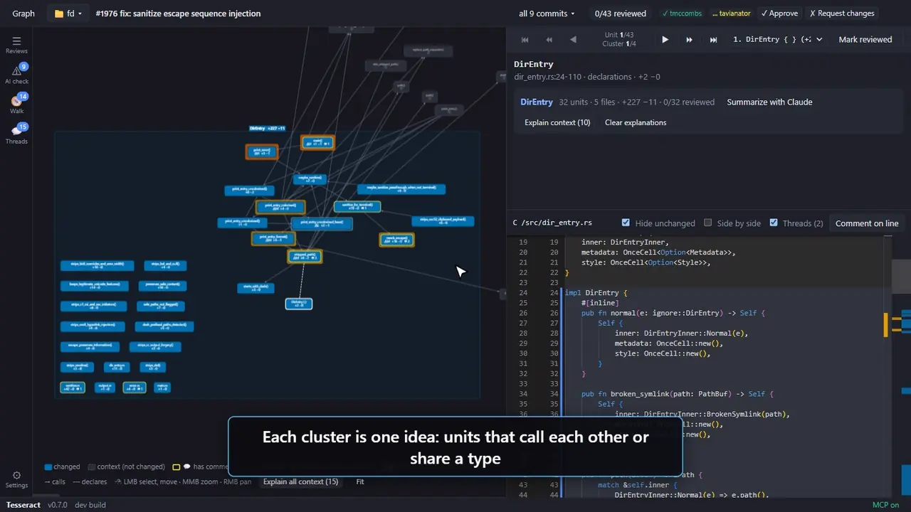

- Units that call each other, or that live in the same class or in a matching `.h`/`.cpp` pair,
  form one cluster. Each cluster has its own color and label.
- Click the cluster name to see its size and how much of it you reviewed.
- "Summarize with Claude" writes a short summary of the cluster: what it does, what existing code
  it touches, and what to check carefully. Summaries are saved.

### 4. Claude explains the context

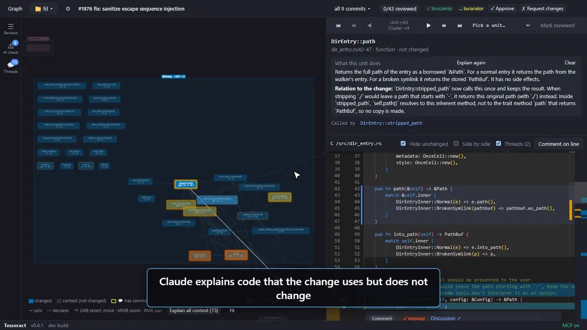

Context code is often new to the reviewer.

- Select a context unit and click "Explain with Claude" to read what it does. A second part,
  "Relation to the change", says how the change affects the unit, or how the unit affects the
  change. Claude reads the diffs of the linked changed units for this.
- "Explain context" in the cluster box explains every context unit around the cluster. "Explain
  all context" in the graph legend explains all context units of the review.
- An explained unit has an ⓘ mark. Hover the node to read the text, or hover a "Calls" or
  "Called by" link.
- The explanations are saved. A new revision of the file makes them stale.
- "Clear" next to an explanation deletes it, and "Clear explanations" in the cluster box deletes
  those of the cluster. "Saved data" in the ⚙ Settings panel shows the size of each kind of saved data.
  Check the kinds to delete, for example explanations, summaries, pre-reviews, walkthroughs or
  downloaded files, and click "Clear checked". This deletes them for all reviews.

### 5. Comments inside the code

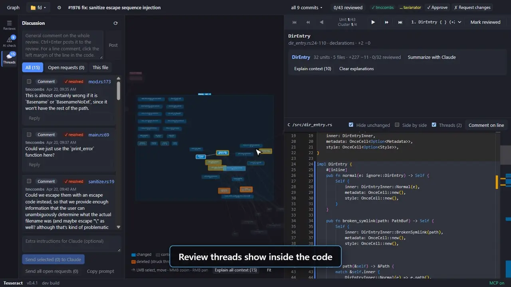

- Threads show in the diff, below the line that they belong to. You can reply there. The "Threads"
  check box in the code toolbar hides them.
- Click the left margin of a line to write a line comment: a change request, a question or a
  comment. "Comment on line" in the code toolbar does the same for the cursor line. Ctrl+Enter
  posts the comment and Escape closes the box.
- Lines with comments have a dot in the margin. Click the dot to open its thread in the Threads
  panel.
- "Hide unchanged" folds the code that did not change. "Side by side" shows the old and the new
  code next to each other.

### 6. Threads, and fixes with Claude Code

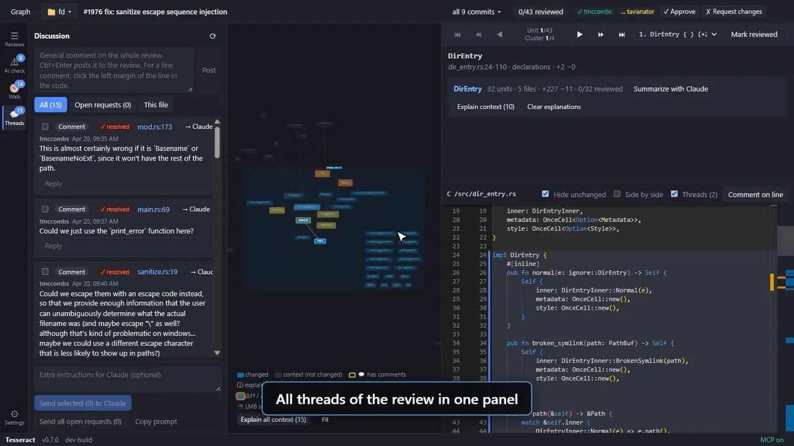

- The Threads panel holds all comments of the review, grouped into threads. A change request stays
  open until somebody replies with discard. On GitHub, a thread stays open until somebody resolves
  it: tick "resolve" next to the reply box.
- Filter the threads: all, open change requests, or only the file that you look at. Click the file
  link in a thread to jump to the commented line.
- Write general comments for the whole review, and replies.
- For the author: select threads and click "Send selected to Claude", or send all open change
  requests. Claude Code opens in a new terminal in your workspace, with the threads and the code
  that the reviewer saw. It changes the files locally and must not check in, commit or push anything.

### 7. AI pre-review of big changes

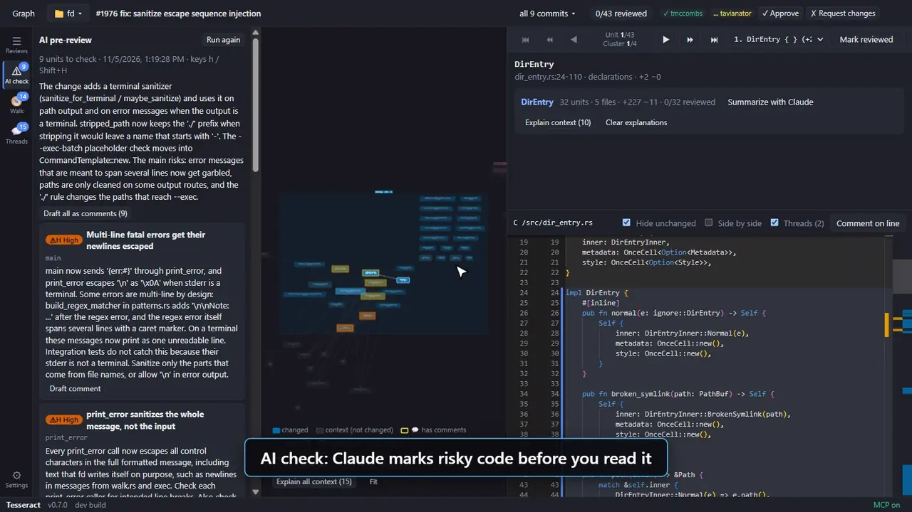

Open the AI check panel and click "Run AI pre-review". Claude reads every changed unit and picks
the ones that a reviewer must check with care: possible bugs, lifetime and threading problems, and
changed behavior that other code depends on.

- The panel shows a short overview and a card for each flagged unit, with the reason. Click a card
  to select its unit.
- Flagged units have a mark in the graph: ⚠H is high, ⚠M is medium, ⚠L is low. The glow around
  the node has the same meaning.
- In the code, a flagged unit has an H, M or L badge on its first line. Hover the badge to read
  the reason.
- The unit dropdown lists the flagged units first. `h` and `Shift+H` step through them.
- "Draft comment" turns a flagged point into a line comment draft. "Draft all as comments" does
  this for every point. High and medium points become change requests, low points become
  questions. You edit the drafts in the Threads panel, then post or discard them.
- The result is saved. A new revision of a file makes it stale.

### 8. Walkthrough of a change

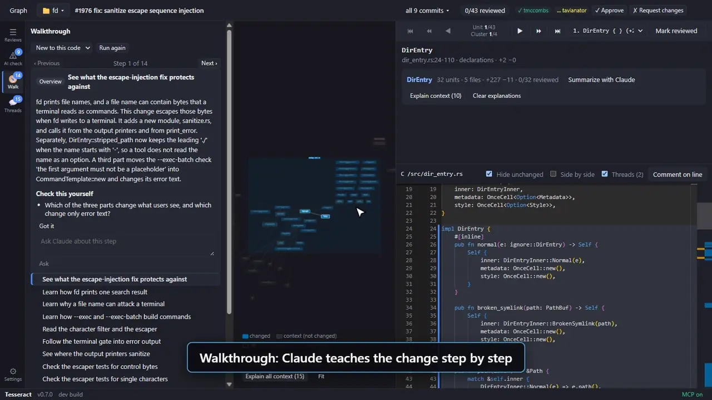

Open the Walk panel (`w`), pick a level, and click "Walk me through". Claude teaches you the change
in short steps, so you understand it before you judge it. This helps most when you do not know the
code.

- "New to this code" first explains the existing code and the ideas that the change builds on. "I
  know this code" goes straight to what changed and why. Each level keeps its own result.
- The first step is an overview. Then come concept steps, and then one step for each group of
  related changes. Blueprint changes get their own steps.
- Each step has a title that says its goal, a short text, and the units it explains. Opening a
  step selects its first unit, so the code shows it. In the graph, the units of the step get a
  bright halo and a double border.
- Each step ends with "Check this yourself" questions. You answer them by reading the code. They
  keep you reading the code instead of only the text.
- "Ask" sends Claude a question about the step. The answer stays with the step.
- "Got it" marks a step as understood. `n` and `p` move between the steps while the panel is open.
- The last page is a recap, with the changed units that no step covers. Read those without help.
- While the panel is open, the AI pre-review marks are hidden, so they do not steer what you read.
- The result is saved. A new revision of a file makes it stale.

### 9. MCP server for AI tools

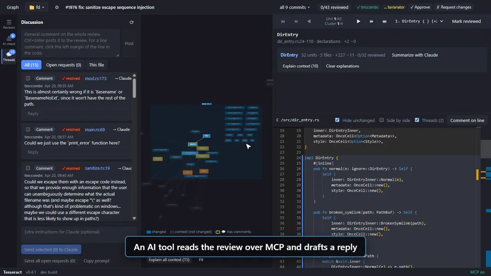

The app runs an MCP server on `http://127.0.0.1:47821/mcp`. An AI tool such as Claude Code can use
it to read the review that is open in the app:

| Tool | What it does |
| --- | --- |
| `list_reviews` | Lists reviews (assigned, mine, recent). |
| `open_review` | Opens a review or a branch, and shows it in the app. |
| `get_overview` | Files, clusters, reading path and open threads. |
| `get_cluster` | Units, relations and diff of one cluster. |
| `get_node` | Callers, callees, comments and diff of one unit. |
| `get_threads` | Comment threads with the code that the reviewer saw. |
| `show_in_app` | Selects a unit in the app, to point you at it. |
| `get_selection` | The unit that you look at now. |
| `draft_comment` | Creates a draft comment. |
| `draft_reply` | Creates a draft reply, optionally a discard. |

An AI never posts directly. Drafts appear in the Threads panel with a purple border. You can edit
a draft, then post it to the review or discard it.

To add the server to Claude Code for your user, click "MCP on" in the top bar to copy this command,
and run it:

```
claude mcp add --transport http --scope user tesseract http://127.0.0.1:47821/mcp
```

## Color-blind support

The colors come from the Okabe-Ito palette, which stays readable for the common kinds of color
blindness. Node text is dark or light, whichever has more contrast with the node color. No meaning
depends on color alone: AI levels have ⚠H, ⚠M and ⚠L marks, comments have a 💬 count, deleted
units have a double border and struck-through text, and context units have a dashed border. In the
diff, added code is blue and removed code is orange.

## Graph controls

| Input | Action |
| --- | --- |
| Mouse wheel | Zoom |
| Middle button drag | Zoom around the start point (drag up to zoom in) |
| Right button drag | Pan |
| Click a node | Select it |
| Click the background | Clear the selection |
| Hover a context node | Show the Claude explanation |
| Hover an arrow | Show the two units that it connects |
| Click an arrow | Select the unit that it points to. When that unit is already selected, select the unit at the other end. |
| Left button drag on a node | Move the node |
| `n` / `p` | Next / previous unit on the reading path. With a walkthrough open: next / previous step. |
| `Shift+N` / `Shift+P` | Next / previous cluster (backwards, first to the start of the current cluster) |
| `Home` / `End` | First / last unit on the reading path |
| `h` / `Shift+H` | Next / previous unit that the AI pre-review flagged |
| `r` | Mark the selected unit as reviewed |
| `d` | Show or hide the Threads panel |
| `a` | Show or hide the AI check panel |
| `w` | Show or hide the Walk panel |
| `g` | Show or hide the graph. Without the graph, the code panel uses the full width. |
| Drag a panel edge | Resize the left panel, the side panel, or the unit details above the code. Double-click the edge to reset it. |

## Requirements

- Windows
- For Plastic: the Plastic SCM / Unity Version Control client, with `cm` on the `PATH`, and a
  Plastic workspace of the repository that you review
- For GitHub: git, the [GitHub CLI](https://cli.github.com) logged in with `gh auth login`, and a
  git clone of the repository that you review. The remote `origin` must point to GitHub.
- Node.js 22 or newer
- [just](https://github.com/casey/just) (`cargo install just`)
- Optional: [Claude Code](https://claude.com/claude-code), logged in, for summaries, explanations and fixes

## Install and updates

Download `Tesseract-<version>-setup.exe` from the
[releases](https://github.com/Simteract/tesseract/releases) and run it. It installs for the current
user, so it needs no admin rights. The installer has no code signature yet, so Windows SmartScreen
can show a warning: click "More info" and then "Run anyway".

The installed app checks the releases for a new version at start and every 4 hours. The bottom
status bar shows the version, the state of the last check, and a "Check for updates" button. The app
downloads the new version in the background, and then the status bar shows "Restart to update". When
you close the app without a click on the button, the update installs at the close.

## Getting started

```
just install
just dev
```

Click the folder button in the top bar and add your Plastic workspace or git clone: type the path
(for example `C:/Plastic/MyProject`) or click "Browse…". The popup keeps a list of workspaces, so you can
switch between projects or remove one from the list.

The AI features (cluster summaries, context explanations and the pre-review) run `claude -p`, so the Claude Code CLI must
be logged in: run `claude` once in a terminal and use `/login`.

## Recipes

| Recipe | What it does |
| --- | --- |
| `just dev` | Starts the app with live reload. |
| `just preview` | Builds once and runs the production build. |
| `just typecheck` | Checks the TypeScript types. |
| `just build` | Builds the app into `out/`. |
| `just package` | Builds `dist/win-unpacked/Tesseract.exe`. Copy the whole folder to run it elsewhere. |
| `just package-installer` | Builds the installer `dist/Tesseract-<version>-setup.exe`. It installs for the current user without admin rights, adds Start menu and desktop shortcuts, and adds an uninstaller. Your settings and cache stay after an uninstall. |
| `just package-portable` | Builds one `dist/Tesseract-<version>-portable.exe`. It starts slower, because it unpacks itself at each start. |
| `just bump <part>` | Raises the version in `package.json`. The part is `patch`, `minor` or `major`. After the merge into `main`, the Release workflow publishes the new version. |

## How it works

- The changes of a branch come from `cm diff br:<branch> --integration`. This shows only the
  changes that the branch adds, without changes that came from merges. For a branch that is
  already merged into its parent, that list is empty. The app then diffs from the last parent
  changeset that was merged into the branch, up to the branch head.
- File revisions come from `cm getfile` and are cached in the app data folder. "✕ Cancel" in the
  status bar stops a load. Files that are already downloaded stay in the cache.
- Reviews, comments and reviewers come from `cm find review`, `cm find changereviewcomment` and
  `cm codereview`.
- On GitHub, the pull requests, comments and reviewers come from `gh`. The app fetches the
  pull request commits with `git fetch`, which does not change your working tree or your branch.
  The changes come from `git diff` between the merge base and the head of the pull request, and
  the file revisions come from `git cat-file`.
- Changed lines are mapped to functions and classes with tree-sitter. Calls are matched by name.

Settings, cached revisions, cluster summaries, explanations, pre-reviews, walkthroughs and drafts
are stored in
`%APPDATA%/Tesseract`.

## Security

- The app uses your own `cm`, `git` and `gh` logins. It stores no passwords or tokens.
- The MCP server listens only on `127.0.0.1`, and it refuses requests from web pages. Any program
  on your computer can still call it, so it can read the open review and add drafts. Drafts are
  posted only when you click "Post".
- Review comments and code come from other people, and they can hold text that tries to give an
  AI orders. The Claude prompts say to treat that text as data. The summaries, explanations and
  the pre-review and the walkthrough run `claude -p` with read-only tools (`Read`, `Grep`, `Glob`). "Send to Claude
  Code" starts an interactive Claude Code session, which asks you before it runs a command, so
  read each request before you allow it.
- The window cannot open links or load other pages, and its renderer runs in the Electron sandbox.

## Known limits

- Calls are matched by name only, so a call to an overloaded or common name can link to the wrong
  unit.
- Callers are found only in the changed files of the review.
- Only C++ and Rust code is parsed. Other files are shown as whole-file nodes.
- Unreal assets must be saved by the editor (not cooked) with UE 4.26 or later. Curve keys and
  other values in a custom binary format are not shown.
- GitHub accepts a line comment only on a line that the diff shows. A comment on another line goes
  on the whole file, with the line number in the text.
- GitHub has no general comment threads, so a reply to a general comment is a new general comment.

## Contributing

Read [CONTRIBUTING.md](CONTRIBUTING.md) before you make a change.

## License

Copyright 2026 Simteract. Tesseract is licensed under the [Apache License 2.0](LICENSE).
